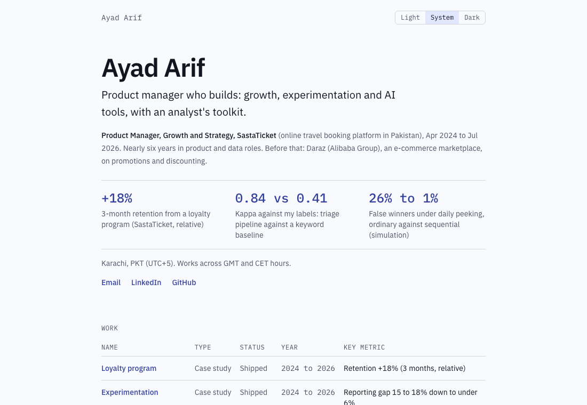
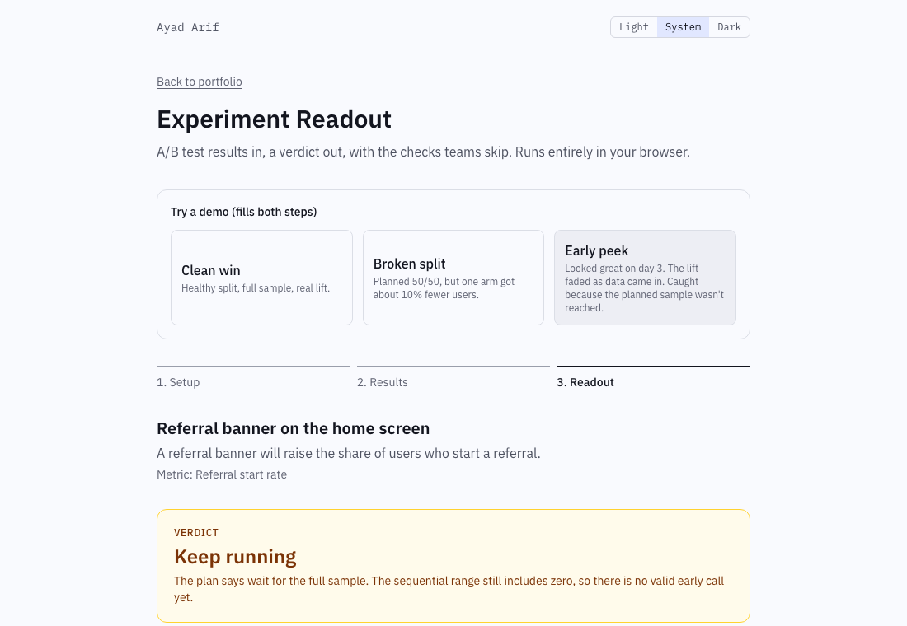
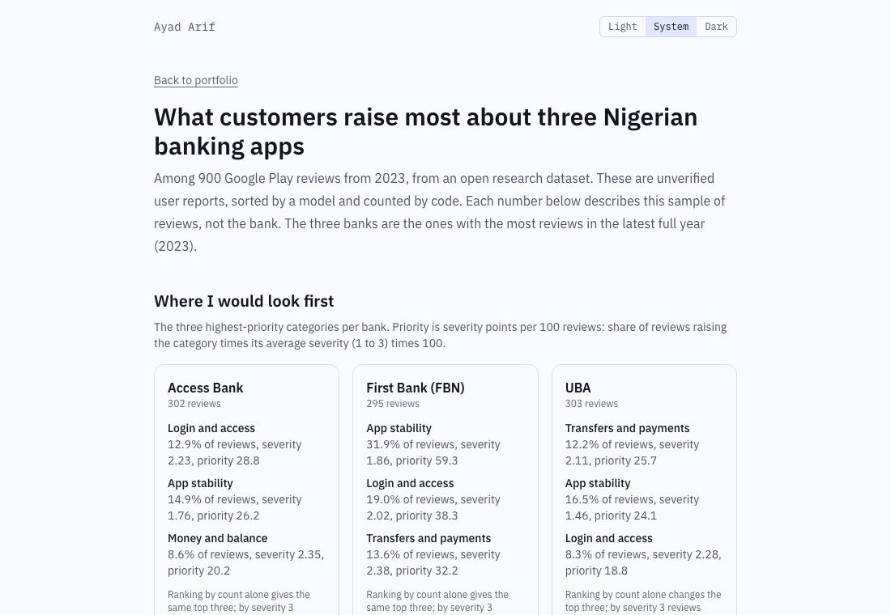
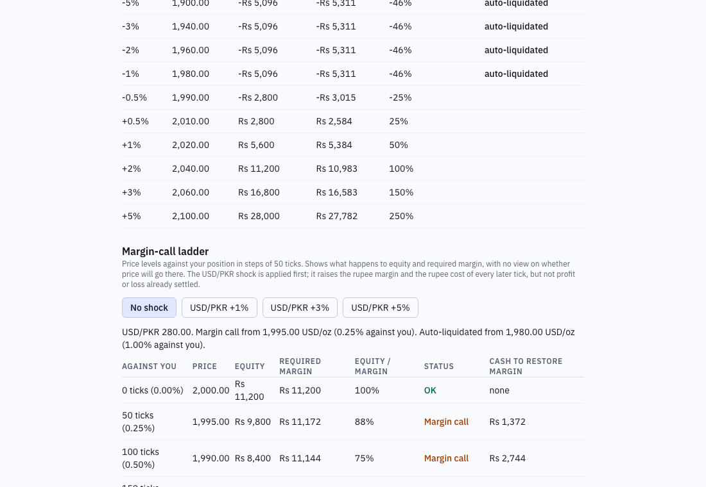

# Ayad Arif: portfolio and tools

Live site: https://aaportfolio-delta.vercel.app (the `main` branch; the redesign is on `sprint` until merged)

Designed, specified and verified by Ayad; built with Claude Code.



A product manager's portfolio with three case studies from SastaTicket and four tools I specified and built with Claude Code. The point of the tools is that each one can be checked: the statistics match scipy and NumPy, the model's labels are scored against my own, and every number on the page comes from saved data or a test.

## The tools

### Experiment Readout (`/experiment-readout`)

**Problem.** Teams stop A/B tests when the number looks good, run uneven splits and pick metrics afterwards. **Audience.** PMs and analysts. **What it does.** Paste daily results; get checks (split, planned sample, power) and one verdict. Below the planned sample only a sequential range, valid under daily checking, can make an early call. A peeking simulator shows why: with no real difference, daily checking called a winner in 26% of simulated tests with the ordinary interval and 1% with the sequential band.
**Decisions.** Rule-based written readout, AI rewrite off (ADR 0005); confidence sequence rather than group sequential (ADR 0001). **Limits.** Binary conversion metrics only; one comparison at a time; the sequential band costs power. **Next.** Per-day sample-ratio checks, multi-variant tests, CUPED (needs per-user data).

### Feedback triage (`/feedback-triage`)

**Problem.** A wall of reviews is not something a PM can act on. **What it does.** A fixed pipeline run with Claude Code sorts 900 public Google Play reviews of three Nigerian banking apps into categories and severities, ranks them with plain code and shows checked quotes. **Evidence.** 100 held-out reviews labelled by me first; five model runs (kappa 0.82 to 0.88); keyword baseline 0.41; batch-size test; 15-item prompt-injection set. All outputs are saved, and CI re-scores them without calling the model (ADR 0002).
**Limits.** One human labeller so far; a second labeller and my own error analysis are in progress, and the page says so. **Next.** Human ceiling with Krippendorff's alpha, a failure taxonomy.

### PMEX contract calculator (`/pmex-calculator`)

**Problem.** Margin, tick value in rupees, break-even and the distance to auto-liquidation are usually worked out by hand. **What it does.** Calculates all of them, plus a margin-call ladder with USD/PKR shocks. A risk tool: no predictions, no signals, no live prices (ADR 0004). **Limits.** Fees modelled from published rate cards, not yet checked against a real statement. **Next.** A touch-probability table, once the barrier formula is verified.

### Five-Minute Brief
A prototype that runs on claude.ai (linked from the site). Not in this repo.

## Run it
```bash
npm install
npm run dev        # http://localhost:3000
npm test           # unit tests (Vitest)
npm run build      # production build
npx playwright test   # accessibility checks (needs: npx playwright install chromium, and a build first)
PYTHONPATH=scripts python3 -m unittest discover -s scripts/tests -v   # Python tests, no model calls
```
Cross-checks against independent code: `scripts/.venv/bin/python scripts/check_stats.py` (scipy), `check_sequential.py` (NumPy, plus an A/A simulation) and `python3 scripts/check_simulator.py` (exact port of the simulator).

## How it is built
Next.js 16, React 19, TypeScript, Tailwind 4, IBM Plex via next/font. Site text is in `src/data/content.ts`. Colours are OKLCH tokens in `src/app/globals.css`; the theme is set before first paint by a small inline script. CI (`.github/workflows/ci.yml`) runs lint, types, unit tests, Python tests, build, axe at 320 px and 1280 px in light and dark, and Lighthouse on five pages.

## Provenance and honesty
I specified the problem, formulas, edge cases and acceptance checks, wrote every decision in `decisions.md` and `docs/decisions/`, labelled the evaluation data and verified outputs against scipy, NumPy and my own labels. Claude Code wrote the implementation and tests to those specs. Learning notes for each tool, with quizzes, are in `docs/learn/`.

## Docs
`docs/decisions/` (ADRs), `docs/model-card.md`, `docs/data-card.md`, `docs/a11y-manual-check.md`, `HANDOFF.md`.
